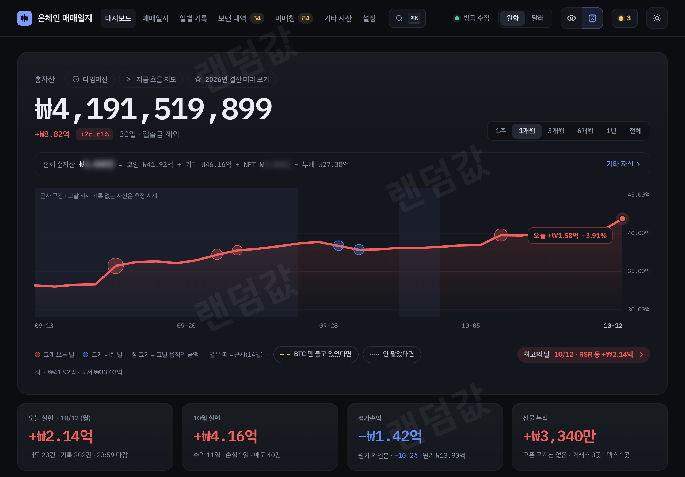

# Trading Journal for Mac

A standalone Mac app for tracking crypto wallets, exchange activity, and your trading journal. Download the DMG, drag the app into Applications, and open it. No Terminal, Python, Node, or coding is needed to use the journal.

**Original project:** [Trading-Journal](https://github.com/extb001-afk/Trading-Journal), by [extb001-afk](https://github.com/extb001-afk) and the tj-bot contributors. The trading engine, dashboard, and integrations are their work. This repository adds the Mac window, bundled runtimes, app lifecycle, and DMG packaging.

## Download and install

**[Download the latest Mac release](https://github.com/jungbtc/Trading-Journal-mac/releases/latest)**

1. Download the `.dmg` file from the release's **Assets**.
2. Open the DMG and drag **Trading Journal** into **Applications**.
3. Open **Trading Journal** from Applications.
4. Choose a journal password. The first-run setup code is entered automatically.
5. Add your wallet addresses and provider or exchange **read-only** API keys in the setup wizard.

The universal app supports **Apple Silicon and Intel Macs running macOS 12 Monterey or later**. Python is bundled inside the app. Internet access and your own provider credentials are needed for live syncing.

The release notes state the exact signing and notarization status. Developer ID signing identifies the distributor; Apple notarization checks the submitted package. These checks do not validate the accuracy of journal calculations.

## What is included

- The original wallet and exchange collectors, local SQLite journal, and dashboard.
- Cost basis, realized/unrealized profit and loss, historical records, and statement exports.
- Upstream NFT, Hyperliquid, additional-asset, and Telegram integration code.
- A native Mac window with standard copy/paste, file saving, and file selection.
- Automatic setup, private local data storage, log rotation, and graceful shutdown.
- **Trading Journal > Open Data Folder**, **Open Logs**, and **Reset Login Password**.



Dashboard screenshot from the original project; amounts are obfuscated. See [the original documentation](README.upstream.md) for the full feature descriptions and upstream caveats.

## Your data

Settings, passwords, provider keys, and journal records stay in:

```text
~/Library/Application Support/Trading Journal/
```

Choose **Trading Journal > Open Data Folder** to find them. The dashboard is available only on this Mac. Replacing or deleting the app does not delete the data folder. The downloadable app contains no personal journal, wallets, passwords, or API keys.

**Leave the app open to sync.** Closing the last window or quitting stops all journal services. Automatic local backups can run while the app is open. Keep a separate backup of the data folder; do not send that folder to friends.

If you forget the journal password, choose **Trading Journal > Reset Login Password**. Your journal and provider keys remain saved.

## Current limits

- **Claude AI is optional and off by default**, as in the original project. Claude Code is not bundled, and this release does not provide a no-code Claude setup flow or start the daily/weekly review worker. Other upstream AI paths require a separately installed, authenticated Claude CLI and their configuration settings.
- No background syncing after quitting, launch-at-login option, or in-app updater. To update, quit the app and install the newer DMG.
- The Mac app forces local-only access; the original project's optional LAN/Tailscale setup is not exposed here.
- Collector child-process recovery is retained. If a top-level service exits, reopen the app. Some detailed health diagnostics still expect PM2 logs.
- Restore, off-site backup scheduling, demo mode, and advanced repair tools are included as source but do not have Mac buttons yet.
- Live wallet, exchange, and Claude connections have not been tested with real credentials for this Mac release. Upstream explicitly describes its broker integrations as unverified.

This is a Mac packaging release of the existing project. Check the original documentation for its calculation limits and estimated-data labels before relying on journal totals.

## Build and verification

For contributors, [macos/README.md](macos/README.md) describes the build, signing, notarization, and checks. The shipped runtime files are copied from upstream commit [`8e9a70c2d7d47dbf59d9afd067946d9d8484b9ab`](https://github.com/extb001-afk/Trading-Journal/commit/8e9a70c2d7d47dbf59d9afd067946d9d8484b9ab), version `2026.10.12.8`.

Checks cover first launch, port conflicts, private file permissions, duplicate instances, password setup/reset, dashboard assets, saved-data persistence, and service shutdown. Both Apple Silicon and Intel runtimes are checked; Intel checks on the development Mac use Rosetta. The bundled runtime also passed the upstream authentication suite: 31 checks.

## Credits and license

- **[extb001-afk](https://github.com/extb001-afk) and tj-bot contributors:** original [Trading-Journal](https://github.com/extb001-afk/Trading-Journal), including the trading engine and dashboard.
- **[jungbtc](https://github.com/jungbtc):** Mac packaging and distribution.
- **[Astral Python Build Standalone](https://github.com/astral-sh/python-build-standalone):** bundled Python 3.12.14 runtimes, release `20260901`.

Distributed under the [MIT license](LICENSE). The original copyright notice is retained. Python and dependency notices are included in [macos/licenses](macos/licenses) and inside the app.

## Support

**Donations are welcome.** If this Mac app is useful to you, you can support its packaging and maintenance at **[buymeacoffee.com/jungjung](https://buymeacoffee.com/jungjung)**.

Report Mac packaging issues in [this repository](https://github.com/jungbtc/Trading-Journal-mac/issues). Credit for the original project remains with its author and contributors.
